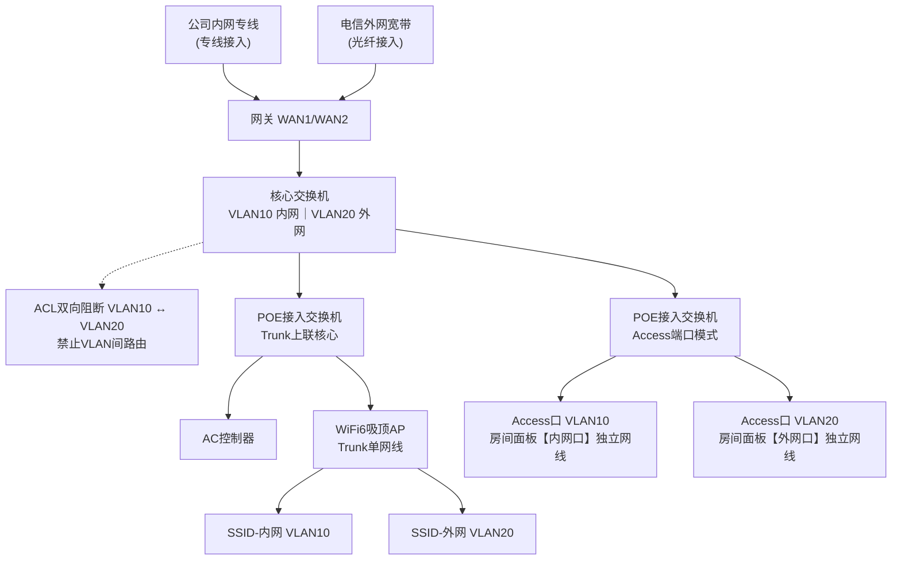
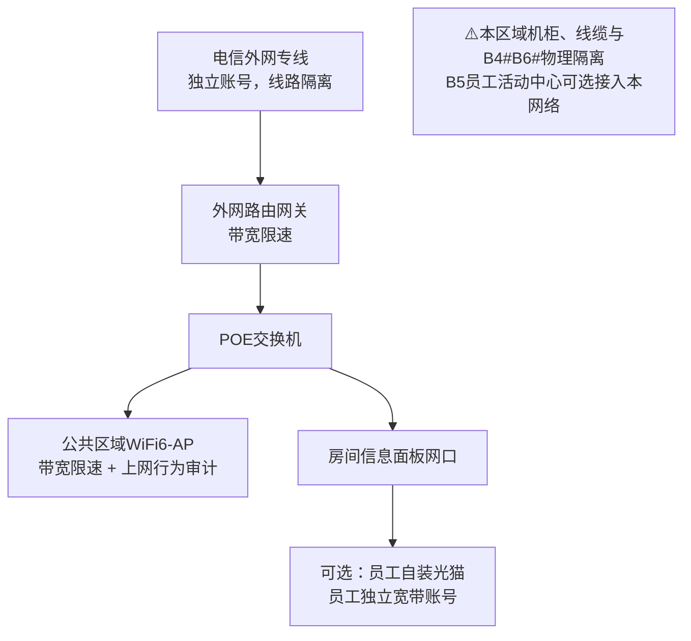

```markdown
# 厦杏摩托 宿舍楼弱电网络方案（B4~B8）
> 文档用途：内部汇报PPT配套技术资料、弱电施工对接、AI检索调用
> 楼栋清单
> - B4#：董事长办公楼
> - B6#：干部宿舍
> - B5#：员工活动中心（可选实施）
> - B7#、B8#：普通员工宿舍

## 1、方案总原则
1. 安全隔离优先，B4#、B6# 内外网VLAN隔离、ACL阻断，不能互通
2. B4#、B6#：双进线、双SSID、房间有线双网口（2根独立网线）
3. B5#：可选项目，按需评估是否本期建设
4. B7#、B8#普通员工宿舍：电信外网方案，独立线路，和高管楼栋物理隔离

## 2、B4#办公楼 / B6#干部宿舍拓扑

⚠️ 重要说明：每房间 2 根独立网线回弱电间，❌禁止房间私接小交换机
> 安全策略：VLAN10 与 VLAN20 双向ACL阻断，内外网之间不可互相访问
> 布线重点：
> - AP：单根网线Trunk，承载两个VLAN无线信号
> - 房间有线双口面板：**每间房2根独立网线回弱电间**，分别划Access VLAN
> - ❌ 禁止房间内加小交换机来分出内外网

## 3、B5# / B7# / B8# 拓扑（仅外网，与B4/B6物理完全隔离）

> 说明：本部分楼栋线路与B4#、B6#完全物理独立，出口互不干扰

## 4、施工关键提醒
1. AP使用Trunk单根网线同时传输两套无线VLAN；
2. B4#、B6#房间有线网口必须敷设2根独立网线，分别接交换机不同Access端口；
3. 严禁在房间内部加装小型交换机实现内外双网。

## 5、各楼栋简要方案（PPT配套摘要）
### B4# 董事长办公楼
- 进线：公司内网专线 + 电信外网宽带双进线
- 无线：双SSID（内网VLAN10 / 外网VLAN20）
- 有线：每间双口面板，2根独立网线，分属VLAN10/VLAN20
- 策略：内外网ACL阻断，董事长IP配置QoS优先
- 覆盖：AC+AP全屋漫游WiFi6

### B6# 干部宿舍
- 进线：公司内网专线 + 电信外网宽带双进线
- 无线：双SSID，内网802.1X认证、外网独立密码
- 有线：每间双口面板，2根独立网线，分属VLAN10/VLAN20
- 策略：内外网ACL双向阻断，不可互访
- 覆盖：AC+AP全屋漫游WiFi6

### B5# 员工活动中心
> ✅ 可选项目，按需实施，看预算和启用进度
- 进线：可单独拉电信外网宽带
- 无线：单SSID公共外网，带宽限速、上网审计
- 不强制纳入本期建设

### B7#、B8# 普通员工宿舍
两套方案可选：
1. 方案A：公司统一接入电信宽带，免费给员工使用
2. 方案B：员工自行向电信单独申请宽带账号

## 6、弱电点位规范
1. B4#、B6#：每间双口面板，2根网线回弱电间，Access端口划分VLAN10/VLAN20
2. B7#、B8#：每间预留单信息面板口
3. B5#：点位按需规划
4. AP：WiFi6吸顶AP，POE供电，AC统一管理
5. 标签规范：网线两端、交换机端口、面板都标注内网/外网+编号，方便排障

## 7、风险点与优化建议
> 格式说明：风险描述｜潜在影响｜优化建议

### 7.1 B4#董事长办公楼 / B6#干部宿舍（双网VLAN隔离区域）

|序号|风险描述|潜在影响|优化建议|
|---|---|---|---|
|1|依靠**ACL双向阻断VLAN10/VLAN20**实现内外网隔离|交换机ACL配置疏漏、漏配、配置被误删除时，会造成高管区域内网、外网互通，存在内网泄密风险|1.优先使用硬件逻辑：核心交换机做**VLAN隔离+私有VLAN/端口隔离**，不只依赖ACL；<br>2.保存ACL配置快照，变更必须走变更审批；<br>3.定期做连通性测试，验证VLAN10与VLAN20确实无法互访；<br>4.禁止在核心上开VLAN间路由接口|
|2|房间敷设2根独立网线，但施工阶段容易接错面板、交换机端口|出现内网口上外网VLAN、外网口跑内网VLAN，高管终端泄露内网；消耗大量排障时间|1.施工完成必须做逐房间端口测试：分别验证两个网口所属VLAN；<br>2.面板、网线、交换机端口标签强制：标注楼栋‑房间‑内网 / 楼栋‑房间‑外网；<br>3.交付输出一份端口对照表文档存档|
|3|明确禁止房间内部接小交换机，但用户私接家用小交换机无法管控|员工在房间把内外网口接家用交换机，造成VLAN混杂，破坏隔离，病毒横向扩散|1.接入交换机开启**端口安全**，限制最大学习MAC数量；<br>2.开启DHCP‑Snooping，防范私接DHCP服务器；<br>3.运维巡检，定期扫描异常MAC；<br>4.制度层面写进宿舍网络使用协议，告知禁止私接交换机后果|
|4|B6干部宿舍内网SSID使用802.1X，但文档缺少账号生命周期说明|人员离职、调岗账号没有及时回收，离职人员仍可以接入公司内网VLAN10|1.对接AD/域做802.1X认证，账号跟随人员权限自动失效；<br>2.建立账号定期复核机制；<br>3.无线内网不允许本地静态账号长期使用|
|5|B4董事长IP配置QoS优先，缺少IP绑定说明|IP被其他设备篡改占用，QoS优先级给到非授权设备|1.交换机端口做IP‑MAC绑定；<br>2.董事长房间内网端口静态分配IP，不使用DHCP动态获取；<br>3.记录该端口配置，禁止随意改动|
|6|AP采用Trunk单根网线承载VLAN10/VLAN20，链路故障没有冗余|POE交换机到AP单线，网线损坏、POE口故障，房间双SSID全部断网|关键点位（董事长办公室、主要干部宿舍）评估增加AP链路冗余；普通点位做好备用POE端口预留；备件留存WiFi6 AP、POE模块|

### 7.2 B7#、B8#普通员工宿舍（物理隔离外网区域）

|序号|风险描述|潜在影响|优化建议|
|---|---|---|---|
|1|方案A（公司统一宽带免费）与方案B（员工自办宽带）二选一，文档没有明确取舍边界|施工、采购阶段反复变更需求，布线、弱电间规划返工|1.明确本期最终选用哪套方案，把废弃方案划掉；<br>2.若保留两套作为备选，补充两套方案对应的成本、运维工作量对比；<br>3.如果混合部署（一部分公司宽带，一部分员工自装），要明确弱电间线路物理分区，严禁线缆混接|
|2|B7/B8和B4/B6描述为物理隔离，但只写线路独立，没有写弱电间机柜物理分隔|施工时把员工宿舍网线和高管楼栋网线进入同一个交换机机柜，误跳线就破坏物理隔离|1.高管楼栋（B4/B6）使用独立机柜，不和B7/B8共用交换机；<br>2.机柜之间做好物理隔断，线缆做颜色区分；<br>3.机柜上锁，权限分开，普通施工人员不能接触高管网络机柜|
|3|B7/B8公共AP做上网行为审计，但**员工房间网口（员工自装光猫）不在审计范围内**|员工房间自行光猫上网流量公司完全不可控，发生网络事件无日志溯源|1.如果采用方案A（公司统一宽带），全部流量经过网关审计；<br>2.如果采用方案B员工自备宽带，文档中明确声明：房间内员工自建宽带不属于公司管控网络，免责说明写入方案和宿舍管理制度；<br>3.公共区域AP必须完整留存审计日志，满足合规留存时长|
|4|B7/B8员工宿舍用户多，带宽缺少带宽规划模型|高峰期网络卡顿，大量员工同时下载、视频占用全部带宽|1.做带宽规划：按最大并发人数做总出口带宽测算；<br>2.网关配置单用户上下行限速，防止个别用户占满整体带宽；<br>3.配置QoS，网页、办公优先，P2P下载限流|

### 7.3 B5#员工活动中心（可选项目）

|序号|风险描述|潜在影响|优化建议|
|---|---|---|---|
|1|B5为可选项目，文档缺少触发启用条件|后期临时追加建设，没有预留机柜、电源、管线，导致后期改造难度大|1.即使本期不实施，弱电间预留机柜空间、电源、管线预埋；<br>2.明确启用触发条件（预算审批通过、启用时间节点）；<br>3.明确如果启用，网络归属：接入B7/B8外网区，严禁接入B4/B6高管网络|

### 7.4 通用施工、文档、运维类风险（全楼栋）

|序号|风险描述|潜在影响|优化建议|
|---|---|---|---|
|1|文档只写文本逻辑拓扑，没有mermaid可视化拓扑图|施工方理解出现歧义，口头理解容易出错|增加Mermaid拓扑图直接写进md，GitHub可以渲染，不需要外部图片文件|
|2|缺少设备选型参考，没有POE功率、交换机型号、网关性能指标|采购设备性能不足，后期出现转发瓶颈、POE供电不足AP反复重启|补充关键设备最低性能指标：核心交换机转发性能、POE总功率、网关带机量、AC管理AP最大数量|
|3|缺少上线测试项清单|施工完直接交付，部分隔离、限速、漫游功能没有验证就投入使用|输出一份上线验收checklist：VLAN隔离测试、漫游测试、POE供电、带宽限速、ACL阻断、审计日志有效性、标签完整性|
|4|运维备份机制未提及|交换机、网关配置丢失后无备份，故障恢复时间长|1.所有网络设备开启配置自动备份；<br>2.配置文件归档到运维知识库；<br>3.记录账号密码台账，专人保管|
|5|故障排障缺少联络、变更流程|网络变更随意修改，出问题无法回溯|明确网络变更审批流程；关键网络变更需要窗口时间；建立故障应急处理步骤|

### 7.5 风险摘要（汇报摘要，可直接用于PPT引用）
> ⚠️ 主要风险摘要
> 1.高管楼栋内外网隔离**不能仅依赖ACL**，需要叠加交换机端口/VLAN隔离手段，同时要管控用户私接小交换机破坏隔离；
> 2.施工必须严格保证B4/B6高管网络与B7/B8员工宿舍**机柜、线路物理隔离，防止误跳线**；
> 3.B7/B8两套建设方案需要确定最终选型，区分「公司管控网络」和「员工自建宽带」的安全责任边界；
> 4.人员账号、IP‑MAC绑定、QoS优先级、审计日志需要配套运维制度，不能只靠设备配置；
> 5.增加可视化拓扑、验收checklist、设备指标，减少施工理解偏差。
```

## 排查小工具（你可以用来自测图是否没问题）
1. 打开网站：https://mermaid.live/
2. 复制第2章节 ```mermaid ... ``` 中间**内部的绘图代码**（不要复制 ```mermaid 和 ``` 这两行标记）粘贴进去。
- 如果live网站能画出图 → 代码本身没问题，问题出在你本地编辑器；
- 如果live网站报错，说明代码语法有问题。

### 本地编辑器看不到图的常见原因
1. Typora：设置 → Markdown → **打开「启用Mermaid图表」**；
2. GitHub raw原始文本页面：看raw是看源码，**必须点开md文件正常预览页面才会渲染图**；raw视图只会显示代码；
3. WPS Markdown、网盘在线预览：**很多不支持Mermaid，永远只显示代码块**，这是软件本身不支持，不是文档错。

> 如果需要发给施工方、WPS打开要看到图片：就去mermaid.live导出PNG图片，把md内的mermaid代码块替换为图片链接 ``。

需要我把「上线验收Checklist」再加到文档末尾吗？
